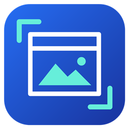

# Salvar Captura



Criei esta ferramenta para facilitar a forma de salvar sua print, sem precisar abrir um programa ou aplicativo de edição de imagens separado. Basta colar a captura, escolher o formato e salvar. Quando necessário, você também pode recortar ou redimensionar a imagem na mesma janela.

## Download para Windows

[**Baixar a versão mais recente**](https://github.com/RFlaimer/salvar-captura/releases/latest)

1. Baixe o arquivo **SalvarCaptura-v1.0.0-Windows.zip** em Releases.
2. Extraia o ZIP para uma pasta que você queira manter.
3. Abra **SalvarCaptura.exe**. Não é necessário instalar.
4. Opcional: execute **Criar atalho.vbs** para adicionar um atalho com ícone na área de trabalho.

## Como usar

- Faça a captura com **Print Screen** e conclua a seleção do Windows.
- Abra a ferramenta e pressione **Ctrl+V** para colar a imagem.
- **Recortar:** selecione com o mouse a área que deseja manter e aplique.
- **Redimensionar:** informe largura ou altura em pixels; a opção de manter proporção vem ativada.
- **Restaurar:** volte à imagem original da última colagem.
- Pressione **Ctrl+S** para escolher o nome e salvar.

A janela de salvamento abre sempre em **Imagens**, com **JPEG (.jpg)** como padrão. Também estão disponíveis PNG, BMP, GIF e TIFF. A prévia se ajusta à janela; o arquivo usa as dimensões indicadas em pixels.

As imagens são processadas localmente. O aplicativo não envia capturas pela internet. Se você salvar em uma pasta sincronizada, como o OneDrive, a sincronização é feita pelo serviço instalado no seu computador.

## Requisitos

Windows 10 ou 11 com .NET Framework 4.x e interface gráfica. A ferramenta é portátil, não exige administrador e inclui ícone no executável e no atalho. O executável não possui assinatura digital.

JPEG utiliza compressão com perda; PNG é útil para textos e transparência. GIF tem paleta reduzida. JPEG e BMP usam fundo branco nas áreas transparentes.

Se a pasta escolhida não permitir gravação, a ferramenta oferece a subpasta **Capturas** ao lado do executável. Mantenha o aplicativo em uma pasta em que sua conta possa gravar.

## Compilar o código

No PowerShell, na pasta do projeto:

```powershell
powershell.exe -NoProfile -ExecutionPolicy Bypass -File .\build.ps1
```

O resultado fica em `dist/`. O script usa o compilador do .NET Framework presente no Windows e não baixa dependências.
